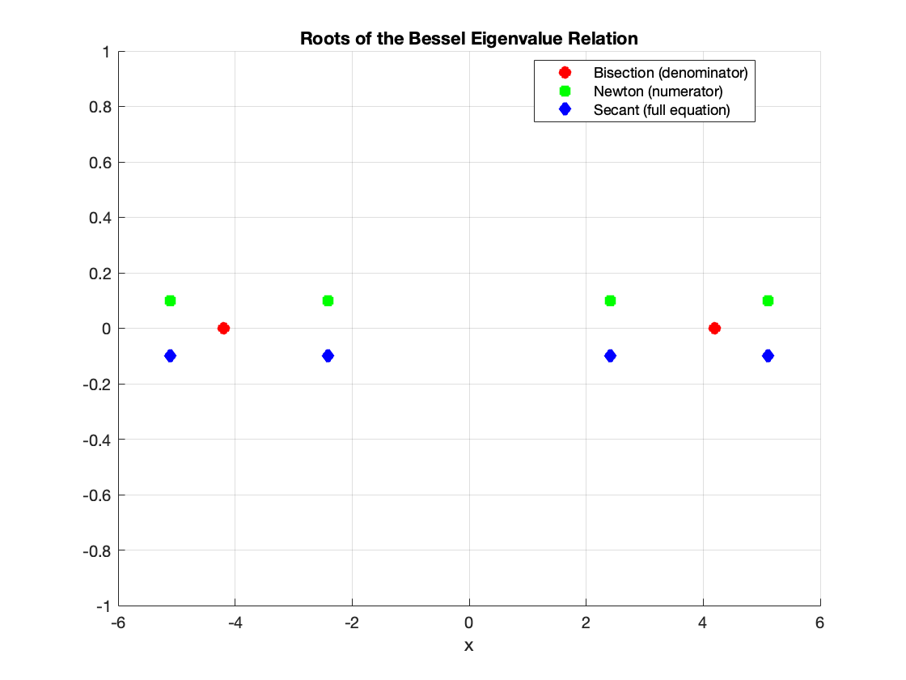

# Root-finding for a Bessel function equation (MATLAB)

Project 1 from my Numerical Methods and Programming module, improved after marker feedback.

In solid mechanics, a special type of elastic wave exists if this equation has a real root other than x = 0:

h(x) = (J_6(x) + J_0(x)) / (J_4(x) - J_2(x)) = 0

where J_n is a Bessel function of the first kind of order n. I wrote three root-finding methods to find the roots, each applied to a different part of the equation.

## Methods

**Bisection, on the denominator f(x) = J_4(x) - J_2(x).** If f changes sign between a and b, there must be a root in between. The method keeps halving the interval, keeping the half where the sign change is, until the interval is smaller than the tolerance. It always converges but is slow. The roots of f are where h(x) blows up, so they're not solutions of the equation, but they show where h is undefined.

**Newton's method, on the numerator g(x) = J_6(x) + J_0(x).** Starting from a guess x0, it follows the tangent line to where it crosses zero:

x1 = x0 - g(x0) / g'(x0)

The derivative is worked out explicitly using the recurrence relation J_n'(x) = (J_{n-1}(x) - J_{n+1}(x)) / 2. Newton's method converges quickly near a root, but fails if the derivative is zero, which happens at x = 0. The function warns if a starting guess doesn't converge.

**Secant method, on h(x) itself.** This works like Newton's method but estimates the derivative from the last two points, so it doesn't need g'(x):

x2 = x1 - h(x1) (x1 - x0) / (h(x1) - h(x0))

It skips starting points where h is undefined.

Each method is run from starting points between -6 and 6, and repeated roots are removed.

## Files

- `f.m`, `g.m`, `h.m`: the denominator, numerator and full equation
- `g_prime.m`: the derivative of g
- `bisection_denominator.m`, `newton_numerator.m`, `secant_wave.m`: the three methods
- `solve_wave.m`: runs all three and plots the roots

## How to run

Put all the files in the same folder and run in MATLAB:

```matlab
solve_wave
```

## Results

The equation has real roots at about x = ±2.41 and ±5.11, so the special wave does exist. Newton's method and the secant method both find these. Bisection finds the points where h is undefined, at about ±4.20.



## References

The methods follow the root-finding material in week 3 of the Numerical Methods and Programming module notes.
